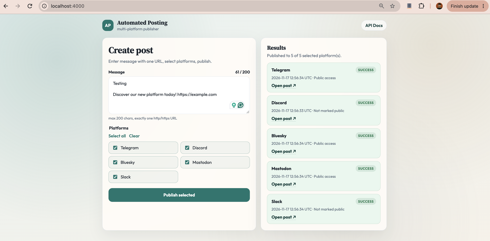
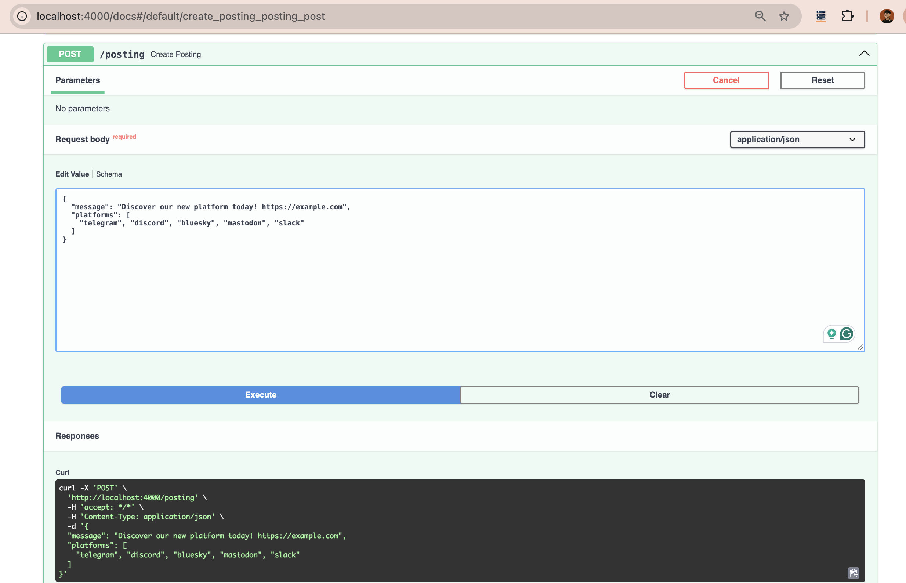
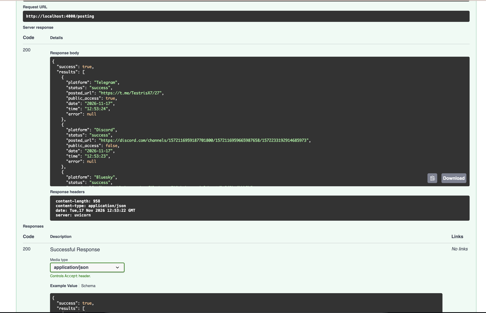
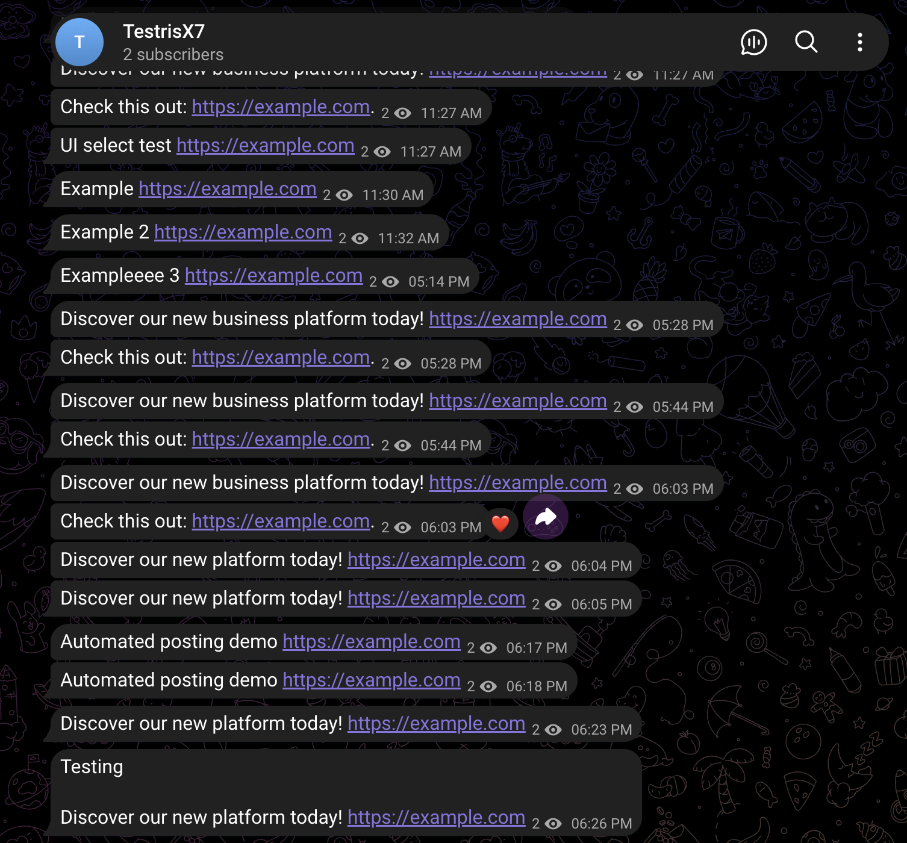
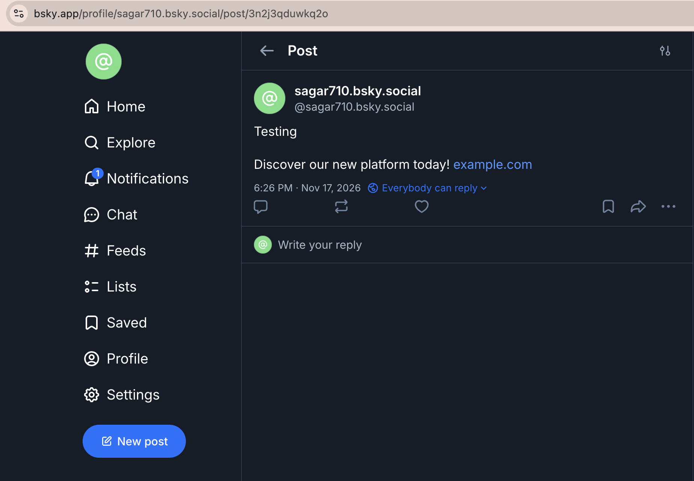
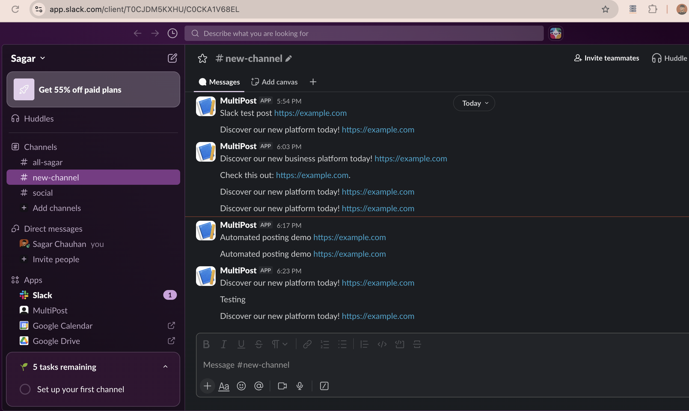

# Automated Multi-Platform Posting System

Simple FastAPI project that takes one message and tries to post it on a few platforms at once.

Right now it supports:
- Telegram
- Discord
- Bluesky
- Mastodon
- Slack

I kept each platform separate, so if one fails the rest still go ahead. That was one of the main things I wanted from this.

## What I used

- Python 3
- FastAPI
- Pydantic / pydantic-settings
- HTTPX
- Uvicorn
- python-dotenv
- Pytest

## Setup

```bash
python3 -m venv venv
source venv/bin/activate        # Windows: venv\Scripts\activate
pip install -r requirements.txt
cp .env.example .env
```

Put your keys in `.env` before trying real posts. Dont commit that file.

## Credentials

**Telegram**
- make a bot from BotFather
- add it as admin in your channel
- set `TELEGRAM_BOT_TOKEN` and `TELEGRAM_CHANNEL_ID`
- optional: `TELEGRAM_PUBLIC_USERNAME` if you want a public link

**Discord**
- Server Settings -> Integrations -> Webhooks
- set `DISCORD_WEBHOOK_URL` and `DISCORD_GUILD_ID`
- only set `DISCORD_PUBLIC_CHANNEL=true` if the channel is actually public

**Bluesky**
- use your handle/email + an app password
- set `BLUESKY_IDENTIFIER` and `BLUESKY_APP_PASSWORD`

**Mastodon**
- need instance URL + access token with `write:statuses`
- set `MASTODON_BASE_URL` and `MASTODON_ACCESS_TOKEN`

**Slack**
- create a Slack app and turn on Incoming Webhooks
- set `SLACK_WEBHOOK_URL`
- `SLACK_CHANNEL_URL` is optional (webhook itself doesnt give a message link)

## Screenshots

UI after posting to all 5:



Swagger request:



Swagger response (200):



Some live posts from my test accounts:





## Notes

- bad input comes back as 422
- if one platform breaks, only that result shows the error
- missing creds for one platform shouldnt block the others
- keep secrets in `.env` only
- Slack webhook just returns `ok`, so I couldnt get a real message permalink from it
